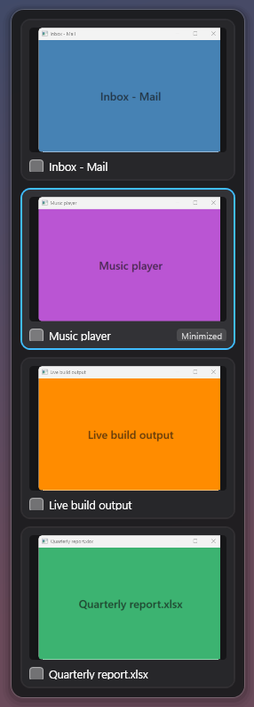
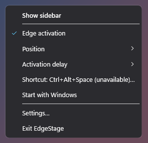

# EdgeStage

A lightweight Windows utility inspired by the window strip of macOS Stage Manager. Rest the
pointer at the left (or right) edge of the screen, or press a shortcut, and a sidebar of **live
previews** of your open windows slides in. Click a preview, or use the arrow keys and Enter, to
switch to that window.

<p>
  
  &nbsp;
  
</p>

*(Screenshots show synthetic test windows; the previews are live DWM thumbnails, not screenshots.)*

## What it does

| Feature | Details |
|---|---|
| Live previews | Desktop Window Manager (DWM) thumbnails, composited by Windows itself, updating in real time. Only registered while the sidebar is visible. |
| Open with a shortcut | Global hotkey, default **Ctrl+Alt+Space**, configurable. The sidebar takes keyboard focus: ↑/↓ (also ←/→, Tab, Home/End, PgUp/PgDn), Enter or Space switches, Esc closes. The previously used window is pre-selected, so *shortcut → Enter* switches back like Alt+Tab. Pressing the shortcut again closes it. |
| Open from the screen edge | Rest the pointer at the edge for 300 ms (configurable). Opens **without** taking keyboard focus, so typing in your app is not interrupted; pick with the mouse, Esc closes. Ignored while a mouse button is held (dragging/resizing windows) and while a full-screen app owns that monitor. Never re-opens while the pointer stays parked at the edge. Can be turned off. |
| Window list | Every switchable window on the current virtual desktop, on all monitors, most-recently-used first with the current window marked. Each window of an app gets its own card. Filtering uses the same structural rules as Alt+Tab (never titles). EdgeStage, the desktop, the taskbar, tool windows, owned dialogs and cloaked windows are excluded. |
| Switching | Choosing a card plays a Stage Manager-style transition: its live preview grows (about 200 ms) from the card to the window's real position and fades into the window, which is activated underneath. Minimized windows zoom to where they will reappear. Skipped when Windows' "Animation effects" is off. If Windows refuses the switch (e.g. an administrator window) a tray notification explains. |
| Closing | Esc, choosing a window, clicking outside (shortcut mode), or moving the pointer away for 400 ms (configurable). |
| Look | Floating rounded charcoal panel, subtle translucency and shadow, rounded cards with the preview inset, app icon and title, hover highlight, accent-colored selection (follows your Windows accent color), "Minimized" badge, 180 ms slide/fade in, 140 ms out. |
| Overflow | Fixed-size cards; the list scrolls with a slim scrollbar. Previews are clipped correctly while scrolling. |
| Close from the card | A small × appears on the card under the pointer; it asks the window to close exactly like the window's own close button (the app may still ask to save). Right-click a card for the same action. |
| Type to filter | While the sidebar has focus (opened with the shortcut), just start typing: cards are filtered by window title or app name; Backspace edits, Esc clears the filter first and closes second. |
| Hidden apps | Right-click a card → "Never show *app* in EdgeStage", or type a program name in Settings. Hidden apps never appear; "Show again" in Settings reverses it. |
| Hold to switch (optional) | Alt+Tab-style: with the shortcut's modifiers held, press its key again to step through windows (add Shift to go back); release the modifiers to switch. A quick tap switches to the previous window. Off by default; needs a shortcut with a modifier. |
| This monitor only (optional) | List just the windows on the monitor the sidebar opens on. |
| Multiple monitors | Opens on the monitor under the pointer; edge zones exist only on outer desktop edges (not between side-by-side monitors); per-monitor DPI aware. |
| Tray icon | Show sidebar · Edge activation · Position (left/right) · Activation delay · Shortcut · Start with Windows · Settings · Exit. |
| Settings window | Shortcut recorder (checks availability, suggests a free alternative when yours is taken), edge on/off, edge side, activation and hide delays, start with Windows, open log folder. Changes apply immediately. |
| Robustness | Survives Explorer restarts (tray icon re-added), display changes, session lock/unlock; single instance; never needs administrator rights; no network access, no telemetry. |

> **Verification status:** everything above is implemented. Several behaviours could only be
> verified by automated checks, not by a person using a real keyboard and mouse: pressing the shortcut,
> physically resting the pointer at the edge, clicking cards or the tray icon, session lock, Explorer
> restarts, multiple monitors and other scaling levels. [docs/TESTING.md](docs/TESTING.md) lists exactly what
> was verified, how, and what still needs a manual check.

Not included: Exposé/Mission Control views, virtual-desktop management, window tiling or grouping, an always-visible strip. See [Roadmap](#roadmap).

## Requirements

- Windows 11 (developed and tested on build 26300). Windows 10 code paths exist but are **untested**.
- x64.
- Framework-dependent build: [.NET 10 Desktop Runtime](https://dotnet.microsoft.com/download/dotnet/10.0) (x64). The self-contained build needs nothing.
- No administrator rights.

## Run it

1. Take `EdgeStage.exe` from `artifacts\SelfContained\` (runs anywhere) or `artifacts\FrameworkDependent\` (needs the .NET 10 Desktop Runtime) — see [Build](#build).
2. Start it. EdgeStage lives in the notification area (tray); a one-time tip explains how to open it.
3. If the default shortcut is already used by another app, EdgeStage says so and offers to pick another one (the edge still works meanwhile). On the development machine Ctrl+Alt+Space was already taken; Alt+` was free.

Command line:

| Argument | Effect |
|---|---|
| *(none)* | Start; if already running, show the sidebar. |
| `--show` | Start if needed and show the sidebar. |
| `--exit` | Ask the running instance to quit. |
| `--autostart` | Used by the "Start with Windows" entry: problems are reported quietly in the tray instead of a window. |

## Settings and files

| What | Where |
|---|---|
| Settings | `%APPDATA%\EdgeStage\settings.json` — human-readable JSON, comments allowed. A bad value resets only that value; an unreadable file is kept as `settings.json.bak` and defaults are used. |
| Logs | `%LOCALAPPDATA%\EdgeStage\logs\edgestage-YYYYMMDD.log` (5 most recent kept). Set `EDGESTAGE_LOG_LEVEL=Debug` for detailed traces. |
| Start with Windows | `HKCU\Software\Microsoft\Windows\CurrentVersion\Run`, value `EdgeStage`. Off by default, toggled from the tray or settings. Respects the Task Manager "Startup apps" switch. |

```jsonc
{
  "schemaVersion": 1,
  "edge": "Left",                 // Left | Right
  "edgeActivationEnabled": true,
  "activationDelayMs": 300,       // 0–2000
  "dismissDelayMs": 400,          // 0–3000
  "hotkey": "Ctrl+Alt+Space",     // e.g. "Alt+`", "Ctrl+Shift+Space", "Win+Alt+W"
  "holdToSwitch": false,          // Alt+Tab-style hold and release
  "onlyPointerMonitor": false,    // list only windows on the sidebar's monitor
  "excludedApps": ["spotify"],    // process names that never appear
  "firstRunTipShown": true
}
```

Uninstall: turn off *Start with Windows*, exit EdgeStage, delete the exe, and optionally delete
`%APPDATA%\EdgeStage` and `%LOCALAPPDATA%\EdgeStage`.

## Build

Prerequisite: .NET SDK 10.0.204 or a later 10.0 feature band (pinned in `global.json`).

```bash
dotnet build EdgeStage.slnx -c Release
```

```bash
dotnet test EdgeStage.slnx -c Release
```

Tests tagged `Desktop` create real windows and need an interactive desktop session; run only the
pure unit tests with `--filter "TestCategory!=Desktop"`.

Publish (outputs go to `artifacts\`):

```bash
dotnet publish src/EdgeStage/EdgeStage.csproj -p:PublishProfile=SelfContained
```

```bash
dotnet publish src/EdgeStage/EdgeStage.csproj -p:PublishProfile=FrameworkDependent
```

| Profile | Output | Size | Notes |
|---|---|---|---|
| `SelfContained` | `artifacts\SelfContained\EdgeStage.exe` | 124.8 MB | Single file, runs on any Windows x64. Single-file compression is deliberately **off**: compressed, it was 58.7 MB but used ~119 MB private memory instead of ~63 MB, because compressed assemblies are inflated into memory. WPF cannot be trimmed. |
| `FrameworkDependent` | `artifacts\FrameworkDependent\EdgeStage.exe` | 0.47 MB | Requires the .NET 10 Desktop Runtime. |

### Distributing

The exe is self-contained; copying it is enough (no installer). For distribution outside your own
machines, sign it with a code-signing certificate (`signtool sign /fd SHA256 /tr <timestamp-url> /td SHA256 EdgeStage.exe`);
unsigned executables trigger SmartScreen warnings. A zip of the single exe plus this README is a
reasonable v1 package.

The icon is generated by `tools\make-icon.ps1` (renders `src\EdgeStage\Assets\EdgeStage.ico`).

## How it works

```
src/EdgeStage.Core/          no WPF; everything testable lives here
  Interop/                   all Win32/DWM P/Invoke (source-generated LibraryImport), SafeHandles
  WindowTracking/            Alt+Tab-style filter, enumeration, WinEvent tracking, MRU order, icons
  Thumbnails/                DWM thumbnail registrations + placement/clipping math
  Activation/                restore + SetForegroundWindow, elevation diagnostics
  Input/                     hotkeys, monitor layout/edge zones, edge state machine, cursor polling, full-screen detection
  Layout/                    sidebar placement and keep-open region
  Settings/, Diagnostics/    JSON settings, Start with Windows, local log
src/EdgeStage/               WPF app: sidebar, cards, settings, tray, controller
tests/EdgeStage.Tests/       MSTest: unit tests + Desktop integration tests
spike/ThumbnailSpike/        Phase 1 proof of concept and measurement tools
tools/                       icon generator, validation scripts
docs/                        spike findings, test report
```

Key decisions (evidence in [docs/spike-findings.md](docs/spike-findings.md)):

- **DWM thumbnails** are the only preview mechanism. They are composited by Windows above the
  sidebar's own content, so EdgeStage computes their placement and scroll clipping itself, and fades
  them per frame together with the panel.
- **Layered (AllowsTransparency) sidebar window** instead of the Windows 11 Acrylic backdrop: Acrylic
  turns flat grey whenever the window is not active, and the edge-opened sidebar is never active.
- **Cursor polling instead of a low-level mouse hook** for the edge (100 ms far from the edge, 40 ms
  near it, stopped while the sidebar is open or edge activation is off). A WH_MOUSE_LL hook would put
  EdgeStage into the system-wide mouse input path, where any pause (e.g. garbage collection) stalls
  the cursor for every app; polling costs ~0.1 % of one core.
- **WinEvent hooks** keep the most-recently-used order (foreground changes only, while hidden) and keep
  the open sidebar current (window create/destroy/show/hide/title/minimize/cloak, only while visible).
- **No focus-lock workarounds.** EdgeStage activates windows only in response to the user's shortcut or
  click, when Windows grants foreground rights; refusals are reported, not circumvented.

## Known limitations

DWM previews:
- **Minimized windows** show the last frame Windows kept before minimizing (labelled "Minimized"); it is not live. If Windows has no frame, the app icon is shown instead.
- **Protected content** (DRM video, some secure apps) appears black — by design of Windows.
- Previews have **square corners** inside the rounded cards (DWM cannot round or mask thumbnails).
- Windows on **other virtual desktops** are not listed (Windows hides them from previews).

Window activation:
- Windows controls who may take the foreground. Switching works in response to the shortcut, a click, or the tray; if Windows still refuses, the card shows a message.
- **Administrator (elevated) windows**: a non-elevated EdgeStage can list and usually preview them, but Windows may block restoring or activating them (User Interface Privilege Isolation). EdgeStage does not elevate itself. Untested on the development machine.
- Exclusive full-screen games can prevent the sidebar from drawing on top.

Input:
- A global shortcut owned by another app is detected and reported; a conflict with a shortcut *inside* an app cannot be detected (the global shortcut wins).
- While an edge-opened sidebar is visible, Esc is reserved for closing it.

Platform:
- Windows 10, multiple monitors with mixed DPI, and display scaling other than 100 % are implemented but were **not tested on real hardware** (see [docs/TESTING.md](docs/TESTING.md)).
- UWP/Store apps can show a generic icon when Windows exposes none.

## Resource use (measured)

Machine: Windows 11 Pro build 26300 (Insider), AMD Ryzen 5 5600X (6 cores/12 threads), 16 GB RAM,
GeForce GTX 1650, one 1920×1080 60 Hz monitor at 100 %, Balanced power plan, .NET 10.0.8.
Method: `tools\validation\measure-resources.ps1` (process CPU time, working set, private bytes,
handles, GDI/USER objects).

| State (Release build) | CPU | Working set | Private | Handles / GDI / USER |
|---|---|---|---|---|
| Idle, sidebar hidden, edge polling on — 60 s, self-contained | 62 ms total = 0.10 % of one core (0.009 % of the CPU) | 104 MB | 63 MB | ~690 / 35 / 34 |
| Same, framework-dependent | 46 ms total = 0.08 % of one core | 102 MB | 62 MB | ~645 / 35 / 34 |
| Sidebar open and idle — 15 s | 94 ms total = 0.6 % of one core | 130 MB | 89 MB | ~700 / 35 / 40 |

Animations: open 181–195 ms (13–14 frames), close 140–156 ms (9–12 frames) at 60 Hz.
Leak check: 254 open/close cycles plus window churn — handles, GDI and USER objects flat; memory
plateaus; 0 DWM registrations left at exit.

## Roadmap

Ideas that are not implemented: grouping windows of the same app, a full-screen overview mode, a per-app preview size, rounded corners on the zoom-to-window animation.

## Testing

See [docs/TESTING.md](docs/TESTING.md) for the full report: 201 automated tests (169 unit, 32 desktop
integration), scripted end-to-end checks with synthetic windows, and the list of checks that require
manual testing.

