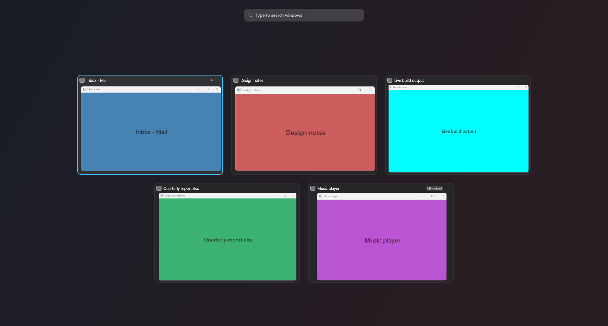

<div align="center">

# 🪟 EdgeStage

### Switch windows from **live previews** at the edge of your screen ✨

*A Stage Manager-style window switcher with an Exposé view, for Windows 10/11*

[](https://github.com/Martin-Atanasov123/EdgeStage/actions/workflows/ci.yml)
[](https://github.com/Martin-Atanasov123/EdgeStage/releases/latest)


[](LICENSE)

**[⬇️ Download](https://github.com/Martin-Atanasov123/EdgeStage/releases/latest)** · [📋 Changelog](CHANGELOG.md) · [🧪 Test report](docs/TESTING.md) · [🤝 Contributing](CONTRIBUTING.md)


&nbsp;&nbsp;




<sub>Screenshots show synthetic test windows. The previews are live Windows thumbnails, not screenshots.</sub>

</div>

---

## 🚀 Quick start

1. ⬇️ **Download** the zip from the [latest release](https://github.com/Martin-Atanasov123/EdgeStage/releases/latest) and unzip it anywhere.
2. ▶️ Run **`EdgeStage.exe`**. It lives quietly in your tray (check the `^` overflow arrow).
3. 🖱️ Move the mouse to the **left screen edge** and rest it for a moment, or press **Ctrl+Alt+Space**.
4. 👆 Click a preview. It grows into that window. Done!
5. 🪟 Press **Ctrl+Alt+Up** (or the grid button in the sidebar) for **Exposé**: every window at once.

> 💡 **Shortcut taken?** If another app already uses Ctrl+Alt+Space, EdgeStage tells you and suggests a free one. The screen edge keeps working meanwhile.
>
> 🛡️ The exe is not code-signed yet, so Windows SmartScreen may ask once: **More info → Run anyway**.

## ✨ What it does

| | Feature | Details |
|---|---|---|
| 🎥 | **Live previews** | Real Windows (DWM) thumbnails that keep updating: a video keeps playing, a terminal keeps scrolling. Only active while the sidebar is open. |
| ⌨️ | **Open with a shortcut** | Default **Ctrl+Alt+Space** (changeable). ↑ ↓ ← → Tab Home End move, **Enter** switches, **Esc** closes. Your previous window is pre-selected, so *shortcut → Enter* flips back like Alt+Tab. |
| 🖱️ | **Open from the screen edge** | Rest the pointer at the edge for 0.3 s. It opens **without stealing focus**, so you keep typing in your app. Ignored while you drag windows or when a full-screen app is running. |
| 🪟 | **Exposé** | **Ctrl+Alt+Up** shows every window at once in an adaptive grid on a dimmed screen. Previews fly out of the real windows and back; ← ↑ → ↓ move through the grid, **Enter** switches, **Esc** returns to where you were. Also from the sidebar's header, the tray, or `EdgeStage.exe --expose`. |
| 🔎 | **Search** | Just start typing in the sidebar or Exposé: filters by window title and app name. Esc clears the search first. |
| 🗂️ | **Group by app** *(optional)* | One collapsible group per app, in the sidebar and in Exposé. Every window stays selectable. |
| ❌ | **Close from the card** | A small × appears on hover (or press **Ctrl+W**); it closes the window like its own X button, never kills the app. If the app is still open after 3 s (e.g. "Save changes?"), the card tells you. |
| 🙈 | **Hidden apps** | Right-click → *Never show this app*, or manage the list in Settings. Applies to both views. |
| 🎬 | **Zoom-to-window animation** | The preview grows from the card into the real window (about 0.2 s), like Stage Manager. Skipped when Windows animations are off. |
| 🔁 | **Hold to switch** *(optional)* | Alt+Tab-style: hold the modifiers, tap the key to step through, release to switch. |
| 🖥️ | **Multi-monitor and DPI aware** | Opens on the screen under your pointer. Optional *this monitor only* mode. |
| 🎨 | **Make it yours** | Dark, Light or System theme · Windows accent, 9 curated colors or any `#RRGGBB` · Compact/Balanced/Spacious · card size, spacing, sidebar width, corner radius · animations on/off, duration, reduce motion. Everything applies live. |
| 🧰 | **Tray and settings** | Open sidebar / Exposé, edge on/off, hidden apps, both shortcut recorders with conflict checks, start with Windows, reset to defaults. |
| 🔒 | **Private and light** | No network, no telemetry, no admin rights. About 0.1 % of one CPU core while idle. |

<details>
<summary>📝 More details on how it behaves</summary>

| Topic | Details |
|---|---|
| Window list | Every switchable window on the current virtual desktop, on all monitors, most-recently-used first with the current window marked. Each window of an app gets its own card. Uses the same structural rules as Alt+Tab (never titles). EdgeStage, the desktop, the taskbar, tool windows, owned dialogs and cloaked windows are excluded. |
| Switching | Restores minimized windows, activates the window (or its open dialog). Minimized windows zoom to where they will reappear. If Windows refuses the switch (for example an administrator window) a tray notification explains. |
| Closing | Esc, choosing a window, clicking outside (shortcut mode), or moving the pointer away for 400 ms (configurable). The first Esc clears a search, the second closes. |
| Exposé | With several monitors it appears on **every display at once**, each showing the windows on that display, so you can pick any window wherever it is; ← → at the edge of a grid jump to the neighboring display, and search filters all of them. Settings › Exposé › Displays can limit it to the display under the pointer, or gather every window on that one display. Card size adapts to the number of windows (density: spacious, auto, denser); with very many windows the grid keeps a readable size and scrolls. Minimized windows and windows on other monitors fade in instead of flying. Pressing the sidebar shortcut switches to the sidebar. |
| Overflow | Fixed-size cards; the list scrolls with a slim scrollbar and previews are clipped correctly while scrolling. |
| Hold to switch | With the shortcut's modifiers held, press its key again to step (add Shift to go back); release to switch. A quick tap switches to the previous window. Needs a shortcut with a modifier. |
| Robustness | Survives Explorer restarts (tray icon re-added), display changes and lock/unlock; single instance. |

</details>

> ✅ **Verification status:** everything above is implemented and covered by automated tests plus scripted checks with synthetic windows. Some things could only be verified automatically, not by a person using a real keyboard and mouse: pressing the shortcuts, physically resting the pointer at the edge, clicking cards, session lock, Explorer restarts, mixed-DPI monitors. [docs/TESTING.md](docs/TESTING.md) lists exactly what was verified, how, and what still needs a manual check.

Not included: virtual-desktop management (Mission Control spaces), window tiling, an always-visible strip. See the [roadmap](#-roadmap).

## 📦 Requirements

- 🪟 **Windows 11** (developed and tested on build 26300). Windows 10 code paths exist but are **untested**.
- 💻 x64.
- 🧩 Framework-dependent build: [.NET 10 Desktop Runtime](https://dotnet.microsoft.com/download/dotnet/10.0) (x64). The self-contained build needs nothing.
- 🙅 No administrator rights.

## ▶️ Run it

| Argument | Effect |
|---|---|
| *(none)* | Start; if already running, show the sidebar. |
| `--show` | Start if needed and show the sidebar. |
| `--expose` | Start if needed and open Exposé; if it is open, close it. Handy for mouse buttons or launcher shortcuts. |
| `--exit` | Ask the running instance to quit. |
| `--autostart` | Used by the "Start with Windows" entry: problems are reported quietly in the tray instead of a window. |

## ⚙️ Settings and files

| What | Where |
|---|---|
| ⚙️ Settings | `%APPDATA%\EdgeStage\settings.json`: human-readable JSON, comments allowed. A bad or mistyped value resets only that value; an unreadable file is kept as `settings.json.bak` and defaults are used. A file from EdgeStage 1.x is converted on first start; the original stays next to it as `settings.v1.json`. |
| 📜 Logs | `%LOCALAPPDATA%\EdgeStage\logs\edgestage-YYYYMMDD.log` (5 most recent kept). Set `EDGESTAGE_LOG_LEVEL=Debug` for detailed traces. |
| 🚪 Start with Windows | `HKCU\Software\Microsoft\Windows\CurrentVersion\Run`, value `EdgeStage`. Off by default, toggled from the tray or settings. Respects the Task Manager "Startup apps" switch. |

```jsonc
{
  "schemaVersion": 2,
  "sidebar": {
    "hotkey": "Ctrl+Alt+Space",     // e.g. "Alt+`", "Ctrl+Shift+Space", "Win+Alt+W"
    "holdToSwitch": false,          // Alt+Tab-style hold and release
    "edge": "Left",                 // Left | Right
    "edgeActivationEnabled": true,
    "activationDelayMs": 300,       // 0-2000
    "dismissDelayMs": 400,          // 0-3000
    "edgeInFullscreen": false,      // let the edge work over full-screen apps
    "onlyPointerMonitor": false,    // list only windows on the sidebar's monitor
    "search": true,
    "grouping": false               // false: most recently used; true: grouped by app
  },
  "expose": {
    "hotkey": "Ctrl+Alt+Up",
    "monitors": "EveryDisplay",     // EveryDisplay | ThisDisplay | AllOnOneDisplay
    "density": "Auto",              // Spacious | Auto | Dense
    "grouping": false,
    "showIcons": true,
    "showTitles": true,
    "search": true
  },
  "appearance": {
    "theme": "Dark",                // Dark | Light | System
    "accent": "System",             // System | Blue | Purple | Pink | Red | Orange | Yellow | Green | Teal | Graphite | "#RRGGBB"
    "layout": "Balanced",           // Compact | Balanced | Spacious
    "cardSize": "Standard",         // Small | Standard | Large (Exposé)
    "cardSpacing": 6,               // 0-24
    "sidebarWidth": 264,            // 220-400
    "cornerRadius": 10,             // 0-20
    "animations": true,
    "animationPercent": 100,        // 50-200, larger is slower
    "reducedMotion": false
  },
  "excludedApps": ["spotify"],      // process names that never appear
  "firstRunTipShown": true
}
```

🗑️ **Uninstall:** turn off *Start with Windows*, exit EdgeStage, delete the exe, and optionally delete `%APPDATA%\EdgeStage` and `%LOCALAPPDATA%\EdgeStage`.

## 🛠️ Build from source

Prerequisite: .NET SDK 10.0.204 or a later 10.0 feature band (pinned in `global.json`).

```bash
dotnet build EdgeStage.slnx -c Release
```

```bash
dotnet test EdgeStage.slnx -c Release
```

Tests tagged `Desktop` create real windows and need an interactive desktop session; run only the pure unit tests with `--filter "TestCategory!=Desktop"`.

Publish (outputs go to `artifacts\`):

```bash
dotnet publish src/EdgeStage/EdgeStage.csproj -p:PublishProfile=SelfContained
```

```bash
dotnet publish src/EdgeStage/EdgeStage.csproj -p:PublishProfile=FrameworkDependent
```

| Profile | Output | Size | Notes |
|---|---|---|---|
| `SelfContained` | `artifacts\SelfContained\EdgeStage.exe` | 124.8 MB | Single file, runs on any Windows x64. Single-file compression is deliberately **off**: compressed it was 58.7 MB but used ~119 MB private memory instead of ~63 MB, because compressed assemblies are inflated into memory. WPF cannot be trimmed. |
| `FrameworkDependent` | `artifacts\FrameworkDependent\EdgeStage.exe` | 0.47 MB | Requires the .NET 10 Desktop Runtime. |

**Releases** are built by GitHub Actions when a `v*` tag is pushed (`.github/workflows/release.yml`). For wider distribution, sign the exe with a code-signing certificate (`signtool sign /fd SHA256 /tr <timestamp-url> /td SHA256 EdgeStage.exe`) to avoid SmartScreen warnings. The icon is generated by `tools\make-icon.ps1`.

## 🧠 How it works

```
src/EdgeStage.Core/          no WPF; everything testable lives here
  Interop/                   all Win32/DWM P/Invoke (source-generated LibraryImport), SafeHandles
  WindowTracking/            Alt+Tab-style filter, enumeration, WinEvent tracking, MRU order, icons
  Thumbnails/                DWM thumbnail registrations + placement/clipping math
  Activation/                restore + SetForegroundWindow, elevation diagnostics
  Input/                     hotkeys, monitor layout/edge zones, edge state machine, cursor polling, full-screen detection
  Layout/                    sidebar placement, card metrics, Exposé grid layout, arrow-key grid navigation
  Settings/, Diagnostics/    JSON settings, Start with Windows, local log
src/EdgeStage/               WPF app: sidebar, Exposé, cards, theme, settings, tray, controller
tests/EdgeStage.Tests/       MSTest: unit tests + Desktop integration tests
spike/ThumbnailSpike/        Phase 1 proof of concept and measurement tools
tools/                       icon generator, validation scripts
docs/                        spike findings, test report
```

Key decisions (evidence in [docs/spike-findings.md](docs/spike-findings.md)):

- 🎞️ **DWM thumbnails** are the only preview mechanism. They are composited by Windows above the sidebar's own content, so EdgeStage computes their placement and scroll clipping itself, and fades them per frame together with the panel. Their square corners are rounded by a small click-through window that covers just the four corners.
- 🪞 **Layered (AllowsTransparency) sidebar window** instead of the Windows 11 Acrylic backdrop: Acrylic turns flat grey whenever the window is not active, and the edge-opened sidebar is never active.
- 🐭 **Cursor polling instead of a low-level mouse hook** for the edge (100 ms far from the edge, 40 ms near it, stopped while the sidebar is open or edge activation is off). A WH_MOUSE_LL hook would put EdgeStage into the system-wide mouse input path, where any pause (for example garbage collection) stalls the cursor for every app; polling costs about 0.1 % of one core.
- 📡 **WinEvent hooks** keep the most-recently-used order (foreground changes only, while hidden) and keep the open sidebar current (window create/destroy/show/hide/title/minimize/cloak, only while visible).
- 🪟 **Exposé reuses the sidebar's machinery**: the same window list, filter and grouping model, the same thumbnail coordinator and corner masks. For the flight, each card gets a render transform that maps its preview exactly onto its window's screen rectangle; the DWM thumbnails follow the transform frame by frame, so at the start every preview covers its real window and the grid grows out of your desktop.
- 🎨 **Themes swap brushes, not windows**: every color is looked up dynamically, so switching Dark/Light/accent recolors open windows at once.
- 🧘 **No focus-lock workarounds.** EdgeStage activates windows only in response to your shortcut or click, when Windows grants foreground rights; refusals are reported, not circumvented.

## ⚠️ Known limitations

**DWM previews**
- 🧊 **Minimized windows** show the last frame Windows kept before minimizing (labelled "Minimized"); it is not live. If Windows has no frame, the app icon is shown instead.
- ⬛ **Protected content** (DRM video, some secure apps) appears black, by design of Windows.
- 🗂️ Windows on **other virtual desktops** are not listed (Windows hides them from previews).
- 🔲 The preview that grows during the zoom animation, and previews while Exposé's cards fly, have square corners (DWM thumbnails cannot be clipped to a rounded shape); the real window's rounded corners and shadow appear when it takes over.
- 🌫️ Exposé's dim is translucent: the real windows stay faintly visible beneath it until the previews land on them.

**Window activation**
- Windows controls who may take the foreground. Switching works in response to the shortcut, a click, or the tray; if Windows still refuses, you get a notification.
- 🛡️ **Administrator (elevated) windows**: a non-elevated EdgeStage can list and usually preview them, but Windows may block restoring or activating them. EdgeStage does not elevate itself. Untested on the development machine.
- 🎮 Exclusive full-screen games can prevent the sidebar or Exposé from drawing on top.

**Input**
- A global shortcut owned by another app is detected and reported; a conflict with a shortcut *inside* an app cannot be detected (the global shortcut wins).
- While an edge-opened sidebar is visible, Esc is reserved for closing it.

**Platform**
- Two monitors at 100 % were tested (scripted, synthetic windows). Windows 10, mixed-DPI monitors and display scaling other than 100 % are implemented but were **not tested on real hardware** (see [docs/TESTING.md](docs/TESTING.md)).
- UWP/Store apps can show a generic icon when Windows exposes none.

## 📊 Resource use (measured)

Machine: Windows 11 Pro build 26300 (Insider), AMD Ryzen 5 5600X (6 cores/12 threads), 16 GB RAM, GeForce GTX 1650, two 1920×1080 monitors at 100 %, .NET 10.0.8. Method: `tools\validation\measure-resources.ps1` (process CPU time, working set, private bytes, handles, GDI/USER objects). Self-contained Release build of 2.0.

| State | CPU | Working set | Private | Handles / GDI / USER |
|---|---|---|---|---|
| 😴 Idle, sidebar hidden, edge polling on, 60 s | 78 ms total = 0.13 % of one core | 98 MB | 64 MB | ~650 / 53 / 30 |
| 👀 Sidebar open and idle, 15 s | 63 ms = 0.4 % of one core | 136 MB | 93 MB | ~700 / 59 / 49 |
| 🪟 Exposé open on both monitors and idle, 15 s | 15 ms = 0.1 % of one core | 144 MB | 142 MB | ~730 / 100 / 66 |
| 😴 Hidden again after Exposé | — | 131 MB | 131 MB | ~705 / 76 / 44 |

🎬 Animations: sidebar open ~185 ms, close ~145 ms; Exposé runs at the display's refresh rate. 🧹 Leak check: 100 sidebar and 50 Exposé open/close cycles plus window churn; handles, GDI and USER objects stay flat, memory returns to its starting level, 0 DWM registrations left at exit. Exposé's overlay windows are released 15 s after it closes. Details in [docs/TESTING.md](docs/TESTING.md).

## 🗺️ Roadmap

Ideas that are not implemented: virtual-desktop views, a per-app preview size, rounded corners on the zoom-to-window and Exposé flight animations, a color picker beyond `#RRGGBB`. Ideas and bug reports are welcome in [Issues](https://github.com/Martin-Atanasov123/EdgeStage/issues).

## 🧪 Testing

See [docs/TESTING.md](docs/TESTING.md) for the full report: automated unit and desktop integration tests, scripted end-to-end checks with synthetic windows (sidebar and Exposé), and the list of checks that require manual testing.

## 📄 License

[MIT](LICENSE) © 2026 Martin Atanasov
